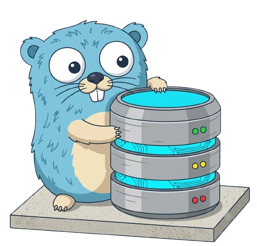

<h2 align="center"><br>copia</h2>

copia is a key/value store written in go. it can keep data in memory or record
changes in a write-ahead log.

### run

```sh
go run ./cmd/copia
```

use `-file` to keep data between runs:

```sh
go run ./cmd/copia -file copia.wal
```

commands:

- `set <key> <value>`
- `get <key>`
- `del <key>`
- `rename <source> <target>`
- `copy <source> <target>`
- `exists <key>`
- `keys [prefix]`
- `count`
- `clear`
- `help`
- `quit`

### package layout

- `cmd/copia` contains the command-line interface.
- `internal/copia` contains the key/value store and entry encoding.

### store usage

```go
var db copia.KV
if err := db.Open(); err != nil {
    return err
}
defer db.Close()

_, err := db.Set([]byte("key"), []byte("value"))
value, found, err := db.Get([]byte("key"))
```

`Set` and `Get` copy byte slices. Use `Open` for an in-memory store or
`OpenFile(path)` to replay and append to a write-ahead log. Operations before
opening or after closing return `copia.ErrNotOpen`.

Use `SetMany` to write several key/value pairs in one batch:

```go
err := db.SetMany([]copia.Entry{
    {Key: []byte("user:1"), Value: []byte("ada")},
    {Key: []byte("user:2"), Value: []byte("grace")},
})
```

`SetMany` copies its keys and values. Repeated keys keep the last value. With a
WAL, the batch is written and synced as one checksummed record, so replay
applies the whole batch or skips an incomplete or invalid record. Batch records
are limited to 64 MiB.

